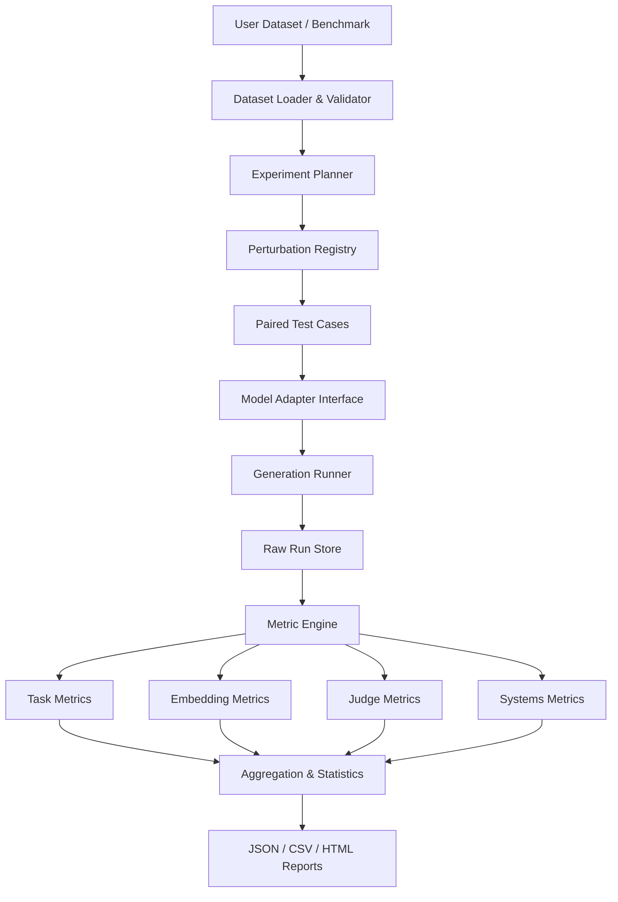

# Resilio Eval — Proposed Python Library Design

> Status: design proposal based on the current Resilio research repository. This document describes a target architecture and recommended evaluation methodology; the interfaces below are not implemented in the existing notebooks yet.

## 1. Product definition

**Resilio Eval** should be a modular Python toolkit for measuring LLM task-performance robustness under controlled prompt perturbations and input distribution shifts.

Its core question:

> Given a clean task and a set of controlled input variations, how much task quality does a model preserve, how does its behaviour change, and what deployment trade-offs appear across model configurations?

### Positioning

Do not position Resilio as a universal replacement for every LLM evaluation framework. Its most credible specialization is:

- Clean-versus-perturbed paired evaluation.
- Prompt perturbation generation and validation.
- Task-quality retention by perturbation family and severity.
- Response consistency as a distinct behavioural signal.
- Comparisons across model versions, inference settings and quantization configurations.

It can integrate with existing benchmark and application-evaluation systems rather than duplicate all their capabilities.

## 2. Scope and non-goals

### Initial scope

1. Load a user-provided dataset.
2. Generate or load controlled perturbations.
3. Run a model through a provider adapter.
4. Evaluate outputs using task-specific metrics and optional LLM judges.
5. Compare perturbed scores with clean baselines.
6. Export raw records and aggregate reports.

### Non-goals for the first release

- Training or fine-tuning foundation models.
- Replacing general knowledge benchmarks such as MMLU or GPQA.
- Claiming a single similarity score represents correctness.
- Treating all text perturbations as semantics-preserving.
- Replacing human review for high-impact decisions.
- Building a hosted experiment-tracking SaaS product before the Python core is stable.

## 3. Core design principles

### 3.1 Separate inference from evaluation

A user should be able to evaluate a model they already host. The evaluation library should not require loading model weights itself.

### 3.2 Make metric meaning explicit

Every metric must declare:

- What it measures.
- Required inputs.
- Valid output range and units.
- Whether higher or lower is better.
- Missing-value behaviour.
- Known limitations.
- Test cases.

### 3.3 Preserve raw evidence

Never store only the final aggregate score. Preserve prompt, perturbation, output, model configuration, metric details, run ID and judge metadata so a result can be reproduced and audited.

### 3.4 Make experiment runs reproducible

Persist stable seeds, perturbation parameters, model revisions, tokenizer revisions, generation settings, embedding model, judge model, rubric version and library version.

### 3.5 Avoid forced composite scores

Show a metric dashboard/profile first. Offer composite scores only when weights are explicitly selected, versioned and validated for the target task.

## 4. Target architecture



### Module boundaries

| Module | Owns | Must not own |
|---|---|---|
| `core` | Experiment orchestration, schemas and run IDs. | Provider-specific API calls. |
| `datasets` | Loading, validation, task metadata and references. | Model inference. |
| `perturbations` | Pure transformations and perturbation metadata. | Model scoring. |
| `adapters` | Model request/response interface. | Metric aggregation. |
| `embeddings` | Embedding model interface and vector operations. | Task correctness. |
| `metrics` | Independent metric implementations. | Experiment file layout assumptions. |
| `aggregation` | Grouping, baseline comparison and statistics. | Calling models. |
| `reporting` | Human-readable and machine-readable exports. | Changing raw evaluation results. |
| `cli` | Command-line interface and config loading. | Duplicating metric algorithms. |

## 5. Proposed package structure

```text
resilio-eval/
├── pyproject.toml
├── README.md
├── LICENSE
├── src/
│   └── resilio_eval/
│       ├── __init__.py
│       ├── core/
│       │   ├── schemas.py
│       │   ├── evaluator.py
│       │   ├── experiment.py
│       │   ├── runner.py
│       │   └── registry.py
│       ├── datasets/
│       │   ├── loader.py
│       │   ├── validation.py
│       │   └── formats.py
│       ├── perturbations/
│       │   ├── base.py
│       │   ├── typos.py
│       │   ├── formatting.py
│       │   ├── slang.py
│       │   ├── structural.py
│       │   ├── truncation.py
│       │   ├── paraphrase.py
│       │   └── multilingual.py
│       ├── adapters/
│       │   ├── base.py
│       │   ├── transformers.py
│       │   ├── openai_compatible.py
│       │   └── custom.py
│       ├── embeddings/
│       │   ├── base.py
│       │   └── sentence_transformers.py
│       ├── metrics/
│       │   ├── base.py
│       │   ├── classification.py
│       │   ├── exact_match.py
│       │   ├── factuality.py
│       │   ├── instruction_following.py
│       │   ├── similarity.py
│       │   ├── consistency.py
│       │   ├── judge.py
│       │   ├── safety.py
│       │   └── performance.py
│       ├── aggregation/
│       │   ├── baseline.py
│       │   ├── robustness.py
│       │   ├── scorecards.py
│       │   └── statistics.py
│       ├── reporting/
│       │   ├── json_report.py
│       │   ├── csv_report.py
│       │   └── html_report.py
│       └── cli.py
├── tests/
│   ├── test_perturbations.py
│   ├── test_metrics.py
│   ├── test_aggregation.py
│   ├── test_adapters.py
│   └── test_reproducibility.py
├── examples/
├── configs/
├── benchmarks/
└── docs/
```

## 6. Core data contracts

Prefer typed, validated data models (dataclasses or Pydantic models). Keep the schema independent of any one provider.

### 6.1 Evaluation case

```python
EvalCase(
    id="classification_001",
    task="classification",
    input="Classify this platform as B2B, B2C, or Hybrid.",
    expected_output="Hybrid",
    expected_label="Hybrid",
    context=None,
    metadata={"domain": "business_models", "language": "en"},
)
```

Recommended fields:

| Field | Required? | Meaning |
|---|---|---|
| `id` | Yes | Stable test-case identifier. |
| `task` | Yes | Task type / metric profile. |
| `input` | Yes | Clean user prompt. |
| `expected_output` | No | Reference answer for generation or Q&A tasks. |
| `expected_label` | No | Gold class for classification. |
| `context` | No | Trusted source context, especially for RAG. |
| `metadata` | No | Domain, language, difficulty, tags and source. |

### 6.2 Perturbation record

```python
PerturbationRecord(
    id="classification_001__typo__v1",
    base_case_id="classification_001",
    family="typo",
    severity=1,
    variant=1,
    input="Clasify this platform as B2B, B2C, or Hybrid.",
    semantics_preserving=True,
    seed=42192,
    parameters={"typo_rate": 0.08},
)
```

A perturbation should declare whether it is intended to preserve meaning. This is a first-class field, not an informal assumption.

### 6.3 Model configuration and response

Record at least:

- Provider / runtime.
- Model identifier and immutable revision where available.
- Tokenizer identifier and revision where available.
- Quantization method, bit width and compute dtype.
- Prompt template and system-prompt version.
- Temperature, top-p, top-k where relevant, max output tokens and repetition penalty.
- Seed and repetition index.
- Input/output token counts.
- Time to first token, total latency and generation duration.
- Error / timeout / finish reason.

### 6.4 Metric result

Every result should contain:

```json
{
  "metric": "classification_accuracy",
  "value": 1.0,
  "scale": "0_to_1",
  "higher_is_better": true,
  "details": {"correct": 9, "total": 10},
  "metric_version": "0.1.0"
}
```

The JSON above is an illustrative target schema, not a record emitted by the existing notebooks.

## 7. Perturbation design

### 7.1 Families for the first release

| Family | Example operators | Default test class |
|---|---|---|
| Character noise | Keyboard typo, insertion, deletion, substitution, transposition | Usually semantics-preserving |
| Formatting | Casing, punctuation, whitespace, line breaks | Usually semantics-preserving |
| Lexical variation | Common abbreviations, slang, spelling variants | Validate; may depend on language/domain |
| Word structure | Word merges, selected function-word deletion | Validate; can change meaning |
| Paraphrase | Meaning-preserving rewrite, synonym substitution | Must be validated |
| Truncation | Prefix cut, sentence removal, omitted constraints | Intent-loss / ambiguity test |
| ASR-like noise | Homophones, word-boundary errors, punctuation loss | Usually intended to model transcription noise; validate |
| Multilingual variation | Code-switching, transliteration, spelling variation | Separate benchmark profile |

### 7.2 Severity should be measured, not assumed

Do not assume L1 is always mild or L5 is always severe. Store the operator parameters and observed input features. Consider recording:

- Character edit distance / normalized edit distance.
- Word error rate for transcript-style perturbations.
- Number of deleted constraints or entities (where annotated).
- Prompt embedding similarity.
- Human label: intent preserved / partly preserved / intent lost.

The semantic-preservation label should be produced or reviewed independently of the model being evaluated. An embedding model alone cannot certify meaning preservation.

### 7.3 Reproducibility requirements

Use local RNG objects and stable seeds:

```python
import hashlib
import random


def stable_seed(case_id: str, family: str, severity: int, variant: int) -> int:
    raw = f"{case_id}|{family}|{severity}|{variant}".encode("utf-8")
    digest = hashlib.sha256(raw).digest()
    return int.from_bytes(digest[:8], "big")


rng = random.Random(stable_seed("case-001", "typo", 1, 2))
```

Avoid Python's process-randomized `hash()` for persisted benchmark seeds. Do not reset module-global random state inside each transformation.

## 8. Model adapter interface

The initial package should support two adapter families:

1. Local Transformers inference.
2. OpenAI-compatible chat-completion endpoints.

A custom adapter protocol can enable other runtimes without changing core logic.

Conceptual interface:

```python
class ModelAdapter:
    def generate(self, messages, generation_config):
        """Return a normalized ModelResponse."""
        raise NotImplementedError
```

`ModelResponse` should include text, model metadata, token counts, latency fields, finish reason and any provider request ID available.

Keep provider libraries as optional dependencies so the core package does not force users to install every inference backend.

## 9. Metric catalogue and recommended use

### 9.1 Input metrics

| Metric | Definition / purpose | Important limitation |
|---|---|---|
| Cosine similarity | Embedding similarity between clean and perturbed prompt. | Not proof of intent preservation. |
| Edit distance | Character-level difference. | Does not capture meaning. |
| Word error rate | Insertions + deletions + substitutions divided by reference word count. | Useful for ASR/transcription-like noise, not every prompt transformation. |
| Perturbation severity | Operator parameters and measured changes. | Must be defined consistently across benchmark versions. |

### 9.2 Task-quality metrics

| Task | Prefer these metrics | Extra evidence |
|---|---|---|
| Classification | Accuracy, macro-F1, precision, recall, confusion matrix | Gold class labels; optional calibration if class probabilities are available. |
| Q&A | Exact match where suitable, token F1, reference-based correctness, calibrated rubric judge | Expected answer or trusted context. |
| Logical reasoning | Correct conclusion, constraint checks, contradiction checks, rubric-based validity | Explicit premises and expected conclusion. |
| Open-ended reasoning | Factuality, completeness, relevance, validity of conclusion | Reference facts or expert-defined rubric; do not require private chain-of-thought. |
| RAG | Faithfulness, context precision/recall, answer relevance, noise sensitivity | Retrieved context and trusted source documents. |
| Agents / tools | Task completion, tool selection accuracy, argument correctness | Full trace and expected tool outcomes. |

Use deterministic checks first when possible. Use an LLM judge when the quality dimension cannot be evaluated adequately with labels, exact rules or reference matching.

### 9.3 Response consistency metrics

Use response embedding similarity, lexical similarity or pairwise comparisons to answer whether the response changes under perturbation. Do not convert response similarity directly into correctness.

Potential outputs:

- Mean clean-to-perturbed response similarity.
- Distribution across variants.
- Standard deviation across repeated generations.
- Pairwise consistency across paraphrases.
- Response divergence by perturbation family.

### 9.4 Judge metrics

A judge plugin should support:

- Configurable rubric and dimension definitions.
- Structured output validation.
- Score scale declaration (0–1 or 0–100).
- Reason / evidence fields.
- Retry and malformed-output handling.
- Model name, version and prompt hash.
- Human-labelled calibration samples.
- Agreement / correlation reports.

The judge must not be told to penalize a response merely because its embedding similarity is below an arbitrary value. The current notebook also labels a response-similarity value as “response divergence” and uses a `< 0.80` rule even though the values loaded from CSV are on a 0–100 scale. The library should use a canonical scale and consistent metric names. The judge should assess correctness against the task and reference, while similarity remains a separate measurement.

### 9.5 System / deployment metrics

For model and quantization selection, collect:

- Total latency.
- Time to first token.
- Output tokens per second.
- Input and output token counts.
- Peak device memory / VRAM where measurable.
- Estimated provider cost where pricing data is available.
- Timeout and failure rate.

These are not present in the current exported result schema and need to be added to the inference adapter.

## 10. Robustness aggregation

Do not use one score without showing the underlying curve.

Let:

- \(S_0\) = clean baseline task-quality score.
- \(S_d\) = mean task-quality score at perturbation severity \(d\).

### 10.1 Absolute performance drop

\[
D_d=S_0-S_d
\]

This reports the score-point loss and remains interpretable when the baseline is small.

### 10.2 Relative performance retention

\[
R_d=\frac{S_d}{S_0}
\]

Only report this when the baseline is non-zero and sufficiently far from zero. Include `S0` and `Sd`; a ratio alone can be misleading.

### 10.3 Robustness curve and AUC

Include the clean baseline as severity zero and plot retained task quality against normalized severity. A normalized trapezoidal AUC summarizes performance across the tested interval.

Use the AUC as a summary, not as a replacement for per-level results. A model can have a good average curve but fail badly on one perturbation family.

### 10.4 Worst-case and variation

Also report:

- Worst-case task score.
- Mean and median by level.
- Standard deviation and confidence intervals.
- Between-variant and between-repeat variability.
- Per-category and per-perturbation-family results.

Bootstrap by base prompt, not by individual variant alone, because variants derived from the same clean prompt are not independent observations.

### 10.5 Composite score

A configurable weighted composite can be offered for dashboards, but:

- Weights must be stored with the run.
- The rubric and weights must have a version.
- Scores from different task profiles must not be combined without a defensible mapping.
- The report must always retain the underlying metrics.

## 11. Parameter selection guide

### 11.1 Parameters common to every experiment

| Parameter | Recommendation |
|---|---|
| Dataset | Include clean prompts, task type, gold output/label where applicable and source metadata. |
| Perturbation family | Select families that resemble the real input failure modes. |
| Severity | Define levels from explicit operator parameters and measured change. |
| Variants | Use multiple independently seeded variants per case and family. |
| Repetitions | Repeat model generations when sampling is enabled; report run variation. |
| Generation config | Match production settings for deployment tests; use deterministic settings for controlled comparisons where appropriate. |
| Model revision | Pin model and tokenizer revisions where possible. |
| Quantization | Record method, bit width, backend and compute dtype, not just `4bit`. |
| Judge | Pin judge model, rubric version, score scale and prompt hash. |
| Random seed | Use stable per-case seeds and store them. |

### 11.2 Recommended parameters by application

| Application | Perturbations | Primary metrics | Secondary metrics |
|---|---|---|---|
| Customer support | Typos, informal language, incomplete requests | Task completion, intent correctness, answer correctness | Tone, response consistency, clarification rate |
| RAG assistant | Query paraphrase, typos, entity variation | Faithfulness, answer correctness, retrieval/context recall | Context precision, input similarity, latency |
| Classification | Typos, punctuation, casing, synonyms | Accuracy, macro-F1, per-class recall | Label consistency, calibration |
| Logical / reasoning | Formatting, lexical variants, paraphrases | Correct conclusion, constraint validity, factuality | Completeness, reasoning-coherence rubric |
| Edge / quantized LLM | Same test suite across model/precision combinations | Task score, robustness retention | Tokens/s, latency, VRAM, failures, cost |
| ASR-to-LLM | Word substitutions, word-boundary errors, punctuation loss | Task correctness, entity/intent retention | WER, clarification rate, response consistency |

### 11.3 Do not use the same metric bundle for every task

Examples:

- `sentiment_label_correctness` is not a general metric for all classification tasks.
- Exact match is excellent for constrained output but too strict for many open-ended answers.
- Embedding similarity is not factuality.
- Response similarity is not answer correctness.
- Throughput does not indicate quality.
- A judge's style preference should not dominate correctness.

## 12. LLM-as-a-Judge validation protocol

Before using judge scores to rank models:

1. Create a representative human-labelled anchor set across every task category and severity.
2. Have at least two reviewers score a subset to understand human disagreement.
3. Compare the judge with human labels using appropriate agreement and correlation measures.
4. Inspect disagreement cases and revise the rubric.
5. Use blinded, randomized output order for pairwise comparisons when applicable.
6. Test for verbosity, position, model-family and style preferences.
7. Pin the judge model and rubric version for each experiment.
8. Revalidate after judge model or prompt changes.
9. Keep judge output, explanations and any evidence fields for audit.

An LLM judge should be treated as a measurement instrument with error, not as unquestionable ground truth. For high-impact decisions, include qualified human review.

## 13. Proposed public API

The target API should feel simple at the top level while preserving detailed experiment configuration.

```python
from resilio_eval import EvalCase, Evaluator, ExperimentConfig
from resilio_eval.adapters import TransformersAdapter
from resilio_eval.perturbations import TypoPerturbation, FormattingPerturbation
from resilio_eval.metrics import ExactMatchMetric, JudgeRubricMetric

cases = [
    EvalCase(
        id="case-001",
        task="classification",
        input="Classify a platform that sells analytics to institutions.",
        expected_label="B2B",
    )
]

adapter = TransformersAdapter(
    model_id="meta-llama/Meta-Llama-3-8B-Instruct",
    quantization="4bit",
)

config = ExperimentConfig(
    perturbations=[
        TypoPerturbation(rate=0.08),
        FormattingPerturbation(punctuation_rate=0.5),
    ],
    variants_per_perturbation=3,
    repetitions=3,
    seed=42,
    metrics=[ExactMatchMetric(), JudgeRubricMetric()],
)

result = Evaluator(adapter).run(cases, config)
result.save("runs/run-001")
```

The public API should have these guarantees:

- Stable case and perturbation IDs.
- No hidden mutation of global random state.
- Clear errors for missing gold labels or incompatible metrics.
- Resumable execution without duplicate result records.
- Provider-neutral output records.
- Raw and aggregate exports.

## 14. Proposed CLI

A future CLI could expose the same functionality:

```bash
resilio dataset validate configs/customer_support.yaml
resilio perturb generate configs/customer_support.yaml
resilio run configs/customer_support.yaml
resilio report runs/run-001 --format html
```

These commands are a proposed interface, not commands that exist in the current repository.

## 15. Output layout

Keep one experiment directory per run:

```text
runs/
└── run-2026-001/
    ├── config.yaml
    ├── manifest.json
    ├── cases.jsonl
    ├── perturbations.jsonl
    ├── generations.jsonl
    ├── metric_results.jsonl
    ├── aggregates.json
    ├── summary.csv
    └── report.html
```

Raw records should be append-safe and de-duplicated by a stable key such as `(run_id, case_id, perturbation_id, model_config_id, repetition)`.

## 16. Testing strategy

### Unit tests

- Every perturbation respects its configured parameters.
- Same seed yields the same perturbation across independent processes.
- Different variants produce intended diversity.
- Semantic-preserving operators do not silently drop required fields in controlled fixtures.
- Truncation is marked as potentially intent-destroying.
- Similarity score scale conversions are correct.
- Metric weights sum to one when a composite is used.
- Baseline ratios handle zero and near-zero baselines explicitly.
- Variance and confidence intervals are computed and labelled correctly.
- Missing or malformed judge responses are retained as errors, not converted to fake zero scores.

### Integration tests

- Fake model adapter returns deterministic outputs.
- One end-to-end test runs clean and perturbed cases.
- Resume does not duplicate completed records.
- JSONL, CSV and HTML exports can be loaded and validated.

### Benchmark validation

- Human review of perturbation semantics.
- Human calibration of judge scores.
- Confidence intervals by base prompt.
- Repeated runs for sampled inference.
- Cross-model tests with identical cases and perturbations.

## 17. Packaging strategy

Use a standard `src/` layout and `pyproject.toml`. Keep the core dependencies small and make inference, embedding and judge integrations optional extras.

Illustrative extras:

```bash
pip install resilio-eval
pip install "resilio-eval[transformers]"
pip install "resilio-eval[embeddings]"
pip install "resilio-eval[judges]"
```

The distribution name `resilio-eval` is a proposal; check package-index availability, ownership and trademark considerations before publishing.

Do not publish until:

- Core schemas and APIs are stable.
- Unit and integration tests pass.
- The license and dataset/model usage rights are documented.
- Secrets and large generated artifacts are excluded from the package.
- A minimal end-to-end example works on a clean environment.
- The documentation distinguishes existing functionality from planned features.

## 18. Recommended development order

| Milestone | Deliverable | Priority |
|---|---|---|
| M0 | Fix reproducibility, scale, L4, judge rubric and BSS statistics | Must do first |
| M1 | Typed schemas, dataset loader, perturbation interface and unit tests | First package foundation |
| M2 | One local Transformers adapter and one API adapter | MVP inference |
| M3 | Exact/classification metrics, embedding similarity and judge rubric plugin | MVP evaluation |
| M4 | Baseline retention, robustness curve, uncertainty and reports | MVP analysis |
| M5 | CLI, caching, resumability, benchmark presets and docs | Usability |
| M6 | Human calibration, more perturbation families, RAG/agent profiles | Research expansion |
| M7 | CI, release automation and PyPI publication | Distribution |

## 19. Recommended first release definition

A credible `0.1.0` should do one thing reliably:

> Take a dataset of clean prompts with optional expected answers, generate reproducible perturbations, run a selected model adapter, calculate task correctness and response-consistency metrics, compare results against clean baselines, and export an auditable report.

It does not need dozens of metrics or ten provider integrations on day one. Correctness, reproducibility and transparent limitations matter more than feature count.
