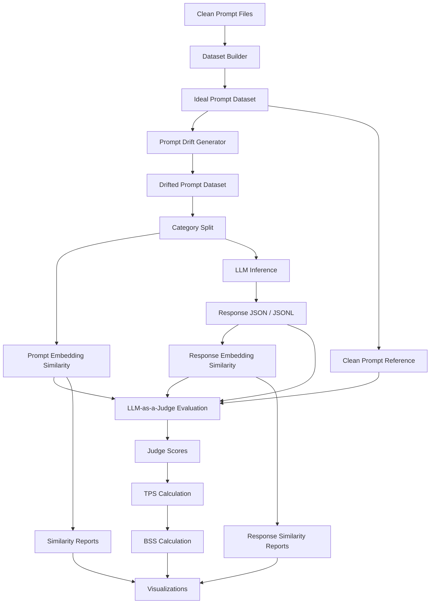

# 🧪 Resilio — LLM Prompt Robustness & Behavioural Stability Evaluation

<p align="center">
  
  
  
  
  
</p>

<p align="center"><b>Measure how reliably language models preserve task performance when real-world user prompts become noisy, informal, incomplete, or structurally degraded.</b></p>

<p align="center">
  Resilio is an experimental LLM evaluation pipeline that compares clean-prompt baselines with model responses to systematically perturbed prompts. It combines prompt perturbation, embedding-based similarity, model inference, LLM-as-a-Judge scoring, weighted task scores, baseline-relative analysis, and visual reporting.
</p>

---

## 📑 Table of Contents

1. [Project Overview](#-01-project-overview)
2. [The Problem](#-02-the-problem)
3. [What Resilio Currently Does](#-03-what-resilio-currently-does)
4. [Existing System Architecture](#-04-existing-system-architecture)
5. [Understanding the Experimental Pipeline](#-05-understanding-the-experimental-pipeline)
6. [Technical Deep Dive](#-06-technical-deep-dive)
7. [Repository Structure](#-07-repository-structure)
8. [Technology Stack](#-08-technology-stack)
9. [Dataset and Experimental Design](#-09-dataset-and-experimental-design)
10. [Current Experimental Outputs](#-10-current-experimental-outputs)
11. [Installation and Environment](#-11-installation-and-environment)
12. [Running the Existing Project](#-12-running-the-existing-project)
13. [Configuration and Parameters](#-13-configuration-and-parameters)
14. [Understanding the Metrics](#-14-understanding-the-metrics)
15. [Current Implementation Limitations](#-15-current-implementation-limitations)
16. [Roadmap: From Research Pipeline to Python Library](#-16-roadmap-from-research-pipeline-to-python-library)
17. [Proposed Library Usage](#-17-proposed-library-usage)
18. [Potential Applications](#-18-potential-applications)
19. [Contributing](#-19-contributing)
20. [Research References](#-20-research-references)

---

# 🎯 01. Project Overview

**Resilio** explores the robustness and behavioural stability of Large Language Models (LLMs) when the wording or structure of a user prompt changes.

LLMs are commonly evaluated using clean, standardized prompts. Real applications receive less controlled inputs: users misspell words, omit punctuation, use abbreviations, write informally, combine instructions, or submit incomplete messages. A model that performs well on a clean prompt may not preserve the same task performance under these conditions.

Resilio creates controlled variations of an original prompt, evaluates the resulting model responses, and compares each result with the clean-prompt baseline.

### Central idea

```text
                 CLEAN TASK PROMPT
                         |
                         v
               PROMPT PERTURBATION
                         |
             +-----------+-----------+
             |                       |
             v                       v
        CLEAN INPUT             PERTURBED INPUT
             |                       |
             v                       v
        LLM INFERENCE           LLM INFERENCE
             |                       |
             v                       v
      BASELINE RESPONSE       PERTURBED RESPONSE
             |                       |
             +-----------+-----------+
                         |
                         v
               RESPONSE EVALUATION
                         |
          +--------------+--------------+
          |              |              |
          v              v              v
      Correctness    Similarity     Performance
          |              |              |
          +--------------+--------------+
                         |
                         v
               ROBUSTNESS ANALYSIS
                         |
                         v
              REPORTS & VISUALIZATION
```

### Project objectives

| Objective | Purpose |
|---|---|
| Prompt perturbation | Generate controlled variations of clean prompts. |
| Input similarity | Estimate how much the perturbed input differs semantically from the original. |
| Model comparison | Compare model families and numerical precision configurations. |
| Response comparison | Measure how responses change relative to each model's own clean baseline. |
| Quality evaluation | Score generated responses against the original task requirements. |
| Robustness analysis | Measure task-performance retention across perturbation levels. |
| Reporting | Organize experiment outputs for statistical analysis and visualization. |

> **Scope:** The current repository is a research prototype implemented primarily through notebooks and standalone scripts. It is not yet an installable, production-ready Python package. The library architecture described later is a proposed development direction, not functionality already available in the repository.

---

# 🧩 02. The Problem

## Why does prompt robustness matter?

Consider a clean prompt:

> Explain how renewable energy can improve electricity-grid reliability.

A user could express a similar request in several ways:

- `Explain how renewble energy improves electricity grid reliability.`
- `explain how renewable energy improves electricity grid reliability`
- `how can renewables help keep the power grid stable?`
- `Explain renewable energy improve grid reliability.`

A robust model should preserve the intended task when the variation does not change the meaning. When important details are removed, the model should recognize the ambiguity instead of inventing missing requirements.

### Two different robustness problems

These should be measured separately:

| Test family | Examples | Expected behaviour |
|---|---|---|
| Semantics-preserving perturbation | Typos, punctuation, casing, whitespace, abbreviations, equivalent paraphrases | Preserve the requested task and answer quality. |
| Intent degradation / ambiguity | Removing constraints, truncating the request, deleting key entities | Identify missing information, make a safe assumption explicit, or ask for clarification. |

A heavily truncated prompt is not necessarily a harder version of the same task. It may no longer contain enough information to define the original task. Resilio should therefore avoid treating every perturbation as if it preserved the original meaning.

### Questions Resilio investigates

1. How much does task quality change when a prompt contains surface-level noise?
2. Which perturbation families cause the largest performance degradation?
3. Do different model families respond differently to the same perturbation?
4. Does model quantization change robustness or response consistency?
5. Does a model preserve the intended task, or does it produce a different but superficially plausible answer?
6. When information is missing, does the model appropriately ask for clarification?

---

# 🚀 03. What Resilio Currently Does

The uploaded experiment contains four prompt categories:

- **Reasoning:** multi-factor explanations and reasoning-oriented questions.
- **Logical:** evaluating implications, rules and logical conclusions.
- **Classification:** assigning categories such as B2B, B2C or Hybrid.
- **Q&A:** answering direct questions with explanations.

The current model experiments cover three model families and three precision configurations:

| Model family | Model used | Configurations |
|---|---|---|
| Meta Llama | `meta-llama/Meta-Llama-3-8B-Instruct` | FP16, 8-bit, 4-bit |
| Microsoft Phi | `microsoft/Phi-3-mini-4k-instruct` | FP16, 8-bit, 4-bit |
| Mistral AI | `mistralai/Mistral-7B-Instruct-v0.2` | FP16, 8-bit, 4-bit |

The result is a comparison of **9 model/precision configurations**.

### Experimental scale in the uploaded repository

| Item | Count |
|---|---:|
| Clean base prompts | 40 |
| Categories | 4 |
| Clean prompts per category | 10 |
| Drift levels | 5 |
| Variants per base prompt per drift level | 3 |
| Perturbed prompts | 600 |
| Prompt conditions including clean baseline | 640 per model configuration |
| Model/precision configurations | 9 |
| Generated response records in exported JSON files | 5,760 |
| Judge evaluation records in exported JSON files | 5,760 |

The uploaded `responses.json` and `judge_scores.json` files contain 160 records per category and model/precision configuration. The totals above describe the exported JSON artifacts, not necessarily every line in the intermediate JSONL checkpoint files.

---

# 🏗️ 04. Existing System Architecture



### Component responsibilities

| Stage | Current implementation | Responsibility |
|---|---|---|
| Dataset preparation | `1_dataset_prep/dataset_builder.py` | Combines category prompt files into `ideal_prompts.json`. |
| Drift generation | `2_prompt_drift_gen/drift_generator.py` | Creates five degradation levels with three variants per level. |
| Category splitting | `2_prompt_drift_gen/split_in_cat.py` | Separates the generated prompts by task category. |
| Prompt similarity | `2_prompts_cossim/` | Compares clean and perturbed prompt embeddings. |
| Model inference | `3_prompt_responses/` | Generates outputs using Transformers models and quantization configurations. |
| Response similarity | `3_responses_cossim/` | Compares each perturbed-input response with the same model's clean-input response. |
| Response evaluation | `4_response_eval/` | Uses an LLM judge to score generated responses. |
| TPS calculation | `5_TPS_calculation/` | Applies category-specific weights to judge dimensions. |
| BSS calculation | `6_BSS_calculation/` | Calculates a baseline-relative ratio across drift levels. |
| Visualization | `5_TPS_visualization/`, `6_BSS_visualization/` | Displays score and similarity trends. |

---

# 🔬 05. Understanding the Experimental Pipeline

## Step 1 — Build the clean dataset

The source prompts are stored in four text files under `1_dataset_prep/prompts/`:

```text
prompts/
├── reasoning.txt
├── logical.txt
├── classification.txt
└── qna.txt
```

`dataset_builder.py` reads non-empty lines and creates records containing an ID, category and prompt text.

The resulting `ideal_prompts.json` contains 40 clean prompts and category metadata.

## Step 2 — Generate prompt drift

`drift_generator.py` applies a cumulative sequence of transformations. Each level contains three generated variants per clean prompt.

| Level | Transformation | Description |
|---|---|---|
| L0 | Clean baseline | Original prompt, unchanged. |
| L1 | Typos | Common misspellings and keyboard-adjacent character substitutions. |
| L2 | Formatting | Lowercasing and probabilistic punctuation removal, in addition to L1. |
| L3 | Slang | Abbreviations, informal substitutions and word distortions, in addition to L1–L2. |
| L4 | Structure | Word merging and selected function-word deletion, in addition to L1–L3. |
| L5 | Informality / truncation | Informal opener and closer, word truncation and capitalization changes, in addition to earlier levels. |

The category configurations use different transformation probabilities. This is intended to create a range of input difficulty, but the actual semantic change must be measured rather than assumed from the level number.

## Step 3 — Measure prompt similarity

The prompt similarity notebook uses:

- `BAAI/bge-large-en-v1.5` from Sentence Transformers.
- Normalized embeddings.
- Cosine similarity.
- Percentage output (`similarity × 100`).

The comparison is between each clean prompt and its corresponding perturbed prompt.

**Interpretation:** This is a proxy for semantic resemblance. It does not prove that the task's meaning was preserved. Embedding similarity should be reported alongside human-validated perturbation labels and task performance.

## Step 4 — Generate model responses

The inference notebook uses Hugging Face Transformers and supports:

- Llama 3 8B Instruct.
- Phi-3 Mini 4K Instruct.
- Mistral 7B Instruct v0.2.

The current quantization configurations are:

| Configuration | Implementation detail |
|---|---|
| FP16 | `torch.float16` model loading. |
| 8-bit | `BitsAndBytesConfig(load_in_8bit=True)`. |
| 4-bit | NF4, FP16 compute dtype and double quantization. |

The inference notebook currently sets:

```python
temp = 0.5
top_p = 0.9
max_token = 384
rep_pen = 1.2
```

It uses sampling (`do_sample=True`) and a system instruction that asks for an answer under 256 tokens. The generation cap and system-level token instruction should be aligned in a future controlled experiment.

The notebook writes incremental JSONL checkpoints and then creates a JSON export.

## Step 5 — Measure response similarity

`3_responses_cossim/responses_cossim.ipynb` uses the same BGE embedding model to compare:

- The model's response to the clean prompt (L0).
- The same model's response to each perturbed version of that prompt.

This is a **response consistency / behavioural similarity** signal. It does not establish answer correctness. A model can produce two similarly worded incorrect answers or two differently worded correct answers.

## Step 6 — Evaluate responses using an LLM judge

`4_response_eval/response_eval.ipynb` builds a judge prompt containing:

- Task category.
- Clean task requirement.
- Actual perturbed prompt.
- Model response.
- Prompt similarity.
- Response similarity.

The current Groq-based notebook calls `openai/gpt-oss-120b` and requests JSON-formatted output. The saved score dimensions are:

- `factual_correctness`
- `logical_correctness`
- `reasoning_coherence`
- `sentiment_label_correctness`
- `manner_of_language`

The repository also contains an OpenRouter evaluation notebook.

**Important:** An LLM judge is an evaluator, not ground truth. Its rubric, model version, score consistency and agreement with human reviewers need to be validated before the scores are used for strong claims.

## Step 7 — Calculate TPS

`5_TPS_calculation/main.py` calculates a weighted score from the five judge dimensions. The exact formula and weights are documented in [Understanding the Metrics](#-14-understanding-the-metrics).

## Step 8 — Calculate BSS

`6_BSS_calculation/BSS_calc.ipynb` compares the mean TPS of three variants at a drift level with the corresponding clean baseline TPS.

## Step 9 — Visualize and compare

The visualization notebooks plot prompt similarity, response similarity, TPS and BSS results across categories, model families, quantization settings and drift levels.

---

# 🧠 06. Technical Deep Dive

## 6.1 Prompt drift transformations

The drift engine is implemented in `DriftTransforms` and `PromptDrifter`.

### Typos

The typo transformation uses a keyboard-adjacency map and a common-typo dictionary. A configurable `typo_rate` controls the chance that an eligible word is modified.

### Formatting

The formatting transformation lowercases the prompt and probabilistically removes punctuation characters. It uses `punct_rate`.

### Slang

The slang transformation uses a word-to-abbreviation map and fallback word distortions. It uses `slang_rate`.

### Structural degradation

The structural transformation can merge adjacent words and remove selected function words. It uses `merge_prob` and `drop_prob`.

### Informality and truncation

The final transformation adds informal openers and closers, truncates the prompt to a sampled prefix length and probabilistically changes word casing. It uses `cut_range` and `caps_prob`.

**Research note:** The first four transformation families can be configured to preserve intent, but that property must be validated. Truncation can remove required task information and should be analyzed as an ambiguity/intent-loss condition.

## 6.2 Embedding-based cosine similarity

For embeddings \(A\) and \(B\), cosine similarity is:

\[
\operatorname{cos}(A,B)=\frac{A\cdot B}{\|A\|\|B\|}
\]

The notebooks normalize embeddings and multiply the cosine similarity by 100 for display.

The similarity score answers:

> How close are these two texts in the embedding space used by this model?

It does not answer:

> Is the model's answer correct?

These questions require separate metrics.

## 6.3 LLM-as-a-Judge dimensions

The existing judge rubric has five dimensions. Their definitions should be clarified and adapted to each task:

| Current field | Intended measurement | Recommended treatment |
|---|---|---|
| `factual_correctness` | Factual validity against the task and trusted references. | Retain; provide reference evidence where possible. |
| `logical_correctness` | Whether the conclusion and supporting claims are logically valid. | Retain for tasks where logical validity applies. |
| `reasoning_coherence` | Whether the explanation is internally coherent and relevant. | Retain as an output-quality measure; do not require hidden chain-of-thought. |
| `sentiment_label_correctness` | Currently named as sentiment/label correctness. | Rename to a task-specific label or classification correctness field; sentiment is not the same as B2B/B2C/Hybrid classification. |
| `manner_of_language` | Clarity, readability and communication style. | Make optional and avoid letting style dominate correctness. |

For classification tasks, use known target labels and deterministic metrics such as accuracy, precision, recall and macro-F1 wherever possible. For open-ended Q&A and reasoning, use references, explicit rubrics and calibrated judges.

## 6.4 Current TPS calculation

The current weighted calculation is:

\[
TPS= w_{FC}FC+w_{SC}SC+w_{LC}LC+w_{RC}RC+w_{ML}ML
\]

All five score values are on a 0–100 scale in the saved judge results.

Current weights:

| Category | FC | SC | LC | RC | ML |
|---|---:|---:|---:|---:|---:|
| Reasoning | 0.30 | 0.05 | 0.25 | 0.30 | 0.10 |
| Logical | 0.25 | 0.05 | 0.35 | 0.25 | 0.10 |
| Q&A | 0.45 | 0.05 | 0.15 | 0.20 | 0.15 |
| Classification | 0.10 | 0.50 | 0.15 | 0.10 | 0.15 |

The weights sum to 1 for each category. They are experiment-specific choices, not universally validated weights. The library should allow custom rubrics and task-specific metric sets.

## 6.5 Current baseline-relative BSS calculation

The current calculation is:

\[
BSS_d=\frac{\operatorname{Mean}(TPS_{d,V1},TPS_{d,V2},TPS_{d,V3})}{TPS_0}
\]

Interpretation:

| BSS value | Interpretation |
|---:|---|
| 1.00 | Same average score as the clean baseline. |
| 0.90 | 90% of the clean baseline score. |
| 0.75 | 75% of the clean baseline score. |
| 1.05 | 105% of the clean baseline score. |

A value above 1 is mathematically valid. This is a ratio, not a bounded 0–1 probability. A zero or near-zero baseline requires special handling rather than silently reporting a zero ratio.

The current code uses `statistics.variance()` and formats the result with a percent sign. A future implementation should report variance in its correct units or report standard deviation / coefficient of variation separately.

---

# 📁 07. Repository Structure

The uploaded project is organized as follows (generated model outputs are represented by their parent directories rather than listing every result file):

```text
Resilio-Achyut/
│
├── 1_dataset_prep/
│   ├── dataset_builder.py
│   ├── ideal_prompts.json
│   └── prompts/
│       ├── classification.txt
│       ├── logical.txt
│       ├── qna.txt
│       └── reasoning.txt
│
├── 2_prompt_drift_gen/
│   ├── drift_generator.py
│   ├── split_in_cat.py
│   ├── drifted_prompts.json
│   └── drifted_prompts/
│
├── 2_prompts_cossim/
│   ├── prompt_cossim.ipynb
│   ├── cos_sim_visualizer.ipynb
│   ├── cossim_stats_maker.ipynb
│   ├── prompt_similarity_outputs/
│   └── prompts_sim_stats/
│
├── 3_prompt_responses/
│   ├── models_inferences.ipynb
│   ├── phi3_inferences.ipynb
│   ├── 16bit-inf.ipynb
│   └── outputs/
│
├── 3_responses_cossim/
│   ├── responses_cossim.ipynb
│   ├── responses_cossim_stats.ipynb
│   ├── resp_cs_visualizer.ipynb
│   └── response_cossim_results/
│
├── 3_responses_n_prompts_cmp/
│   ├── comp.ipynb
│   ├── prompt_vs_response.csv
│   └── prompt_vs_response_with_with_mean.csv
│
├── 4_response_eval/
│   ├── response_eval.ipynb
│   ├── response_eval_using_openrouter.ipynb
│   └── judge_scores/
│
├── 5_TPS_calculation/
│   ├── main.py
│   └── TPS_calculation.ipynb
│
├── 5_TPS_visualization/
│   └── TPS_vis.ipynb
│
├── 6_BSS_calculation/
│   ├── BSS_calc.ipynb
│   └── BSS/
│
└── 6_BSS_visualization/
    └── BSS_viz.ipynb
```

---

# 🧰 08. Technology Stack

| Technology | Current role |
|---|---|
| Python | Dataset generation, inference orchestration and metric calculations. |
| Jupyter Notebook / Google Colab | Interactive experiment execution. |
| Hugging Face Transformers | Loads and runs language models. |
| PyTorch | Model execution and FP16 inference. |
| BitsAndBytes | 8-bit and 4-bit model loading. |
| Sentence Transformers | Creates sentence embeddings. |
| BAAI BGE Large EN v1.5 | Embedding model used for prompt and response similarity. |
| scikit-learn | Cosine similarity calculation. |
| NumPy / Pandas | Data processing and tabular aggregation. |
| Groq | Hosted judge inference in the current evaluation notebook. |
| OpenRouter | Alternative judge workflow in a separate notebook. |
| Matplotlib / Seaborn | Experiment visualization. |
| tqdm | Progress display. |

---

# 📊 09. Dataset and Experimental Design

### Base prompt distribution

| Category | Clean prompts |
|---|---:|
| Reasoning | 10 |
| Logical | 10 |
| Classification | 10 |
| Q&A | 10 |
| **Total** | **40** |

### Prompt-condition structure

Each base prompt has:

- One clean baseline record (L0).
- Three generated variants at each of five drift levels (L1–L5).

Therefore:

\[
N_{conditions}=40\times(1+5\times3)=640
\]

This is 640 conditions per model/precision configuration.

### Dataset limitations

The current experiment is a useful prototype, but 10 prompts per category is a small sample. The categories are also narrow. Before making general claims about LLM robustness, expand the dataset across domains, task formats, languages and user-input styles, and report uncertainty around aggregate results.

For semantics-preserving tests, manually validate a representative sample of perturbations to ensure that the required task and answer have not changed. Store this label in the dataset.

---

# 📈 10. Current Experimental Outputs

The uploaded repository contains response, judge, similarity, TPS and BSS outputs for the nine model/precision configurations.

The following table shows the mean TPS across the 40 base prompts and four categories at the clean baseline (L0) and most degraded level (L5), computed from the saved TPS results:

| Model / precision | L0 mean TPS | L5 mean TPS |
|---|---:|---:|
| Llama 3 8B FP16 | 92.11 | 68.53 |
| Llama 3 8B INT8 | 92.60 | 66.63 |
| Llama 3 8B INT4 | 93.14 | 67.50 |
| Phi-3 Mini FP16 | 88.47 | 58.40 |
| Phi-3 Mini INT8 | 88.12 | 53.81 |
| Phi-3 Mini INT4 | 84.91 | 54.39 |
| Mistral 7B FP16 | 93.11 | 66.28 |
| Mistral 7B INT8 | 92.61 | 66.42 |
| Mistral 7B INT4 | 92.79 | 66.97 |

These numbers reproduce the current stored experiment; they are **not independently validated rankings**. The LLM judge rubric, metric scaling, perturbation reproducibility and sampling controls need improvement before interpreting small differences between configurations.

### Prompt similarity trend in the saved experiment

The category-level prompt similarity CSVs show decreasing average similarity as the cumulative drift levels increase. This confirms that the generated levels create progressively different text according to the selected embedding model. It does not establish that every prompt retains the same intent.

---

# 💻 11. Installation and Environment

## Current notebook-based workflow

The repository does not currently include `requirements.txt`, `pyproject.toml`, a package installer, or a unified command-line interface. The notebooks install their own dependencies and use environment-specific paths, including Google Colab / Google Drive locations.

A combined starting environment for the existing notebooks can be created with:

```bash
python -m venv .venv
```

Activate it, then install the dependencies used across the notebooks:

```bash
pip install torch transformers accelerate bitsandbytes
pip install sentence-transformers scikit-learn numpy pandas tqdm
pip install groq python-dotenv
pip install matplotlib seaborn jupyter
```

The exact compatible versions depend on the Python version, operating system, CUDA version and available GPU. BitsAndBytes 4-bit / 8-bit workflows are hardware- and platform-dependent; use a supported Linux/Colab GPU environment for the existing notebook path unless you have verified your local configuration.

### API credentials

The Groq judge notebook reads the `GROQ_API` environment variable. Store credentials in environment variables or a local `.env` file that is excluded from version control. Do not commit API keys.

---

# ▶️ 12. Running the Existing Project

The following describes the current experimental sequence. It is not yet a single automated end-to-end command.

1. **Build clean prompts:** from `1_dataset_prep/`, run `dataset_builder.py` after confirming its relative prompt paths.
2. **Generate drifted prompts:** from `2_prompt_drift_gen/`, run `drift_generator.py` after confirming the path to `ideal_prompts.json`.
3. **Split by category:** run `split_in_cat.py` from the directory where its `drifted_prompts/` output folder exists.
4. **Calculate prompt similarity:** execute `2_prompts_cossim/prompt_cossim.ipynb` after setting the dataset and output paths for your environment.
5. **Generate model responses:** configure the model and task category in `3_prompt_responses/models_inferences.ipynb`, then run the inference cells. Repeat for each model/precision/category combination.
6. **Calculate response similarity:** execute `3_responses_cossim/responses_cossim.ipynb` after updating the response and output directories.
7. **Evaluate responses:** configure the judge credentials and paths in `4_response_eval/response_eval.ipynb` or use the alternative OpenRouter notebook.
8. **Calculate TPS:** execute `5_TPS_calculation/main.py` or its notebook after correcting the input path for your operating system.
9. **Calculate BSS:** execute `6_BSS_calculation/BSS_calc.ipynb` after confirming the TPS input path.
10. **Visualize:** use the notebooks in `5_TPS_visualization/` and `6_BSS_visualization/`.

> **Path warning:** Several notebooks contain absolute Google Colab / Drive paths, while scripts use relative paths and one calculation script uses Windows-style path notation. Update these paths for your environment before execution. The project does not yet provide a portable CLI that runs all stages automatically.

---

# ⚙️ 13. Configuration and Parameters

Important parameters in the current experiment include:

| Parameter | Current example | Role |
|---|---|---|
| `typo_rate` | Category-dependent, approximately 0.08–0.12 | Probability of eligible word typo changes. |
| `punct_rate` | Category-dependent, approximately 0.65–0.85 | Probability of punctuation removal. |
| `slang_rate` | Category-dependent, approximately 0.45–0.60 | Probability of slang substitution or distortion. |
| `merge_prob` | Category-dependent, approximately 0.25–0.45 | Word-merge parameter. |
| `drop_prob` | Category-dependent, approximately 0.35–0.40 | Function-word deletion parameter; implementation needs correction. |
| `cut_range` | Category-dependent, approximately 0.60–0.75 | Fractional prefix-retention range for L5. |
| `caps_prob` | Category-dependent, approximately 0.05–0.08 | Probability of changing a word to uppercase. |
| `temperature` | 0.5 | Sampling temperature in model generation. |
| `top_p` | 0.9 | Nucleus-sampling parameter. |
| `max_new_tokens` | 384 | Generation cap; currently inconsistent with the system prompt's 256-token instruction. |
| `repetition_penalty` | 1.2 | Repetition penalty in generation. |
| Embedding model | `BAAI/bge-large-en-v1.5` | Model used for prompt and response similarity. |
| Judge model | `openai/gpt-oss-120b` via Groq notebook | Model used for rubric-based evaluation. |

For a fair model comparison, keep the dataset, perturbation variants, generation settings, number of repeats and scoring rubric constant across model configurations.

---

# 📐 14. Understanding the Metrics

Resilio should always distinguish the following questions:

| Question | Appropriate measurement |
|---|---|
| Did the input meaning change? | Human-validated perturbation label plus input similarity / edit features. |
| Did the answer remain correct? | Gold labels, references, deterministic checks or calibrated judge. |
| Did the answer wording or semantics change? | Response similarity and repeated-run variation. |
| Did performance degrade? | Absolute score drop and baseline-relative retention. |
| Did the model become slower or more expensive? | Latency, token throughput, memory and cost. |

### Recommended reporting bundle

Do not rely on one composite score. For each model and task, report:

1. Clean baseline quality.
2. Quality by perturbation family and severity.
3. Absolute performance drop from baseline.
4. Baseline-relative retention.
5. Worst-case performance.
6. Response consistency as a separate signal.
7. Confidence intervals or variation across prompts and repeated runs.
8. Latency, throughput, memory and cost when comparing deployment configurations.

See [`LIBRARY_DESIGN.md`](LIBRARY_DESIGN.md) for the proposed metric API, recommended formulas, parameter guide and package architecture.

---

# ⚠️ 15. Current Implementation Limitations

The following issues were identified while inspecting the uploaded source code and result files.

| Priority | Finding | Recommended change |
|---|---|---|
| Critical | Similarity values are stored as percentages (0–100), while the judge prompt uses a threshold of `0.80`. The judge text also calls the supplied response-similarity value “response divergence”. | Normalize units, use consistent metric names and define score scales centrally. |
| Critical | L4 reuses one random draw for merge and drop checks. | Use independent random draws for each transformation. |
| Critical | `hash()` is used to build perturbation seeds. | Use a stable hash algorithm and a local random generator. |
| High | `sentiment_label_correctness` is used across task categories, including non-sentiment classification. | Replace with task-specific metrics or a clearly defined generic label-correctness field. |
| High | Response cosine similarity is treated as a stability signal but can be mistaken for correctness. | Keep it separate from task-quality metrics. |
| High | The BSS variance value is formatted with a percent sign. | Report variance, standard deviation or coefficient of variation correctly. |
| High | Inference uses sampling and only one generated response per prompt condition. | Add controlled seeds and repeated trials; report uncertainty. |
| High | L5 truncation can remove task requirements. | Mark it as intent-loss / ambiguity testing rather than automatically semantics-preserving drift. |
| Medium | The system instruction says under 256 tokens while generation permits 384 new tokens. | Align the instruction and generation cap. |
| Medium | JSONL checkpoint line counts are inconsistent with exported JSON counts in several configurations (for example, the Mistral FP16 reasoning checkpoint contains 411 lines while its exported `responses.json` contains 160 records). | Make checkpointing idempotent and deduplicate by sample/run ID. |
| Medium | Paths are hard-coded for Colab, Drive or Windows. | Use a configuration file and portable `pathlib` paths. |
| Medium | No packaging metadata, dependency lock, automated tests or unified CLI are included. | Build a standard `src/` package, tests, `pyproject.toml` and CLI. |
| Research | Only 40 clean prompts are present (10 per category). | Expand the benchmark and report uncertainty; validate perturbation semantics. |
| Research | Judge scores are not shown to be calibrated against human annotations. | Create a human-labelled anchor set and measure judge agreement. |

These limitations do not make the experiment useless. They define the engineering and research work required to make its results reproducible and its metrics trustworthy.

---

# 🛠️ 16. Roadmap: From Research Pipeline to Python Library

The recommended development sequence is:

### Phase 1 — Stabilize the research implementation

- Fix deterministic seeding and L4 transformation probabilities.
- Normalize all metric scales.
- Correct the judge rubric and task-specific score dimensions.
- Separate semantics-preserving perturbations from intent-loss tests.
- Fix JSONL checkpoint duplication and portable path handling.
- Add unit tests for every transformation and formula.

### Phase 2 — Create the package foundation

- Add `src/resilio_eval/` and `pyproject.toml`.
- Define dataset, model response, run and metric-result schemas.
- Convert notebook logic into importable Python modules.
- Keep notebooks as examples and exploratory analysis, not the main implementation.

### Phase 3 — Add adapters and metric plugins

- Local Hugging Face / Transformers adapter.
- OpenAI-compatible API adapter.
- Configurable embedding provider.
- Deterministic task metrics and rubric-based judge metrics.
- Custom perturbation and metric registration.

### Phase 4 — Add reproducible experiment orchestration

- Repeated generations and controlled random seeds.
- Model, tokenizer, quantization and generation metadata.
- Caching, retries, resumable runs and error records.
- Cost, latency, token and memory measurements.

### Phase 5 — Reporting and validation

- JSONL raw records and CSV aggregate reports.
- HTML experiment report.
- Confidence intervals and per-category comparisons.
- Human-versus-judge validation.
- Regression tests for known prompts and model changes.

### Phase 6 — Publish and maintain

- Documentation and worked examples.
- Continuous integration and release workflow.
- Versioned metric definitions and benchmark configurations.
- Publish to PyPI after checking package-name availability and licensing.

---

# 🧑‍💻 17. Proposed Library Usage

The following is a **design sketch for a future API**. It does not run against the current notebook repository yet.

```python
from resilio_eval import EvalCase, Evaluator, ExperimentConfig
from resilio_eval.adapters import TransformersAdapter
from resilio_eval.perturbations import (
    TypoPerturbation,
    FormattingPerturbation,
    SlangPerturbation,
)
from resilio_eval.metrics import (
    ExactMatchMetric,
    SemanticSimilarityMetric,
    JudgeRubricMetric,
    PerformanceRetentionMetric,
)

cases = [
    EvalCase(
        id="classification_001",
        task="classification",
        input="Classify this platform as B2B, B2C, or Hybrid.",
        expected_output="Hybrid",
    )
]

model = TransformersAdapter(
    model_id="meta-llama/Meta-Llama-3-8B-Instruct",
    quantization="4bit",
    generation={
        "temperature": 0.0,
        "max_new_tokens": 256,
    },
)

config = ExperimentConfig(
    perturbations=[
        TypoPerturbation(rate=0.08),
        FormattingPerturbation(punctuation_rate=0.5),
        SlangPerturbation(rate=0.4),
    ],
    variants_per_perturbation=3,
    repetitions=3,
    seed=42,
    metrics=[
        ExactMatchMetric(),
        SemanticSimilarityMetric(),
        JudgeRubricMetric(),
        PerformanceRetentionMetric(),
    ],
)

results = Evaluator(model).run(cases, config)
results.to_json("resilio-results.json")
results.to_csv("resilio-summary.csv")
```

The API should make each component configurable while preserving a common experiment schema. A user should be able to evaluate an existing model endpoint without having to adopt Resilio's own inference stack.

---

# 🌍 18. Potential Applications

| Application | What to test with Resilio |
|---|---|
| Customer-support assistants | Typos, informal language, incomplete customer messages and intent retention. |
| Enterprise chatbots | Instruction adherence and robustness to variable employee phrasing. |
| RAG applications | Changes in query wording, retrieval quality, answer grounding and noise sensitivity. |
| Edge LLM deployment | Quality, latency, memory and throughput across quantization configurations. |
| Speech-to-text pipelines | ASR spelling errors, missing punctuation and transcript noise. |
| Education assistants | Robustness to student shorthand, incomplete questions and varied levels of language proficiency. |
| Prompt / model regression testing | Performance changes after prompt edits, model upgrades or inference-setting changes. |

Resilio is best suited to offline benchmarking, pre-deployment qualification and regression testing. It should not be the sole safety or quality approval mechanism for high-impact systems.

---

# 🤝 19. Contributing

Contributions should preserve reproducibility and keep experimental assumptions explicit.

Suggested contribution areas:

- New perturbation operators with documented severity and semantic-preservation properties.
- Task-specific datasets with references or gold labels.
- Model adapters for local runtimes and hosted APIs.
- Deterministic metric implementations.
- Judge calibration and human-evaluation tooling.
- Statistical reporting and visualization.
- Unit tests and execution portability.

Before submitting a new metric, document its input requirements, output scale, interpretation, limitations and test cases.

---

# 📚 20. Research References

The following projects and papers provide useful context. Resilio should be positioned as a focused experimental toolkit within this broader evaluation ecosystem, not as a replacement for existing general evaluation frameworks.

1. Zhu et al., [PromptRobust: Towards Evaluating the Robustness of Large Language Models on Adversarial Prompts](https://arxiv.org/abs/2306.04528), 2023.
2. Zhu et al., [PromptBench: A Unified Library for Evaluation of Large Language Models](https://arxiv.org/abs/2312.07910), 2023.
3. Romanou et al., [BrittleBench: Quantifying LLM Robustness via Prompt Sensitivity](https://arxiv.org/abs/2603.13285), 2026.
4. [EleutherAI Language Model Evaluation Harness](https://github.com/EleutherAI/lm-evaluation-harness).
5. [Stanford HELM](https://crfm.stanford.edu/helm/).
6. [DeepEval metric documentation](https://deepeval.com/docs/metrics-introduction).
7. [Ragas metric documentation](https://docs.ragas.io/en/latest/concepts/metrics/available_metrics/).

---

<p align="center"><b>Resilio — Evaluating not only what an LLM can answer, but how reliably it answers when real-world inputs change.</b></p>
